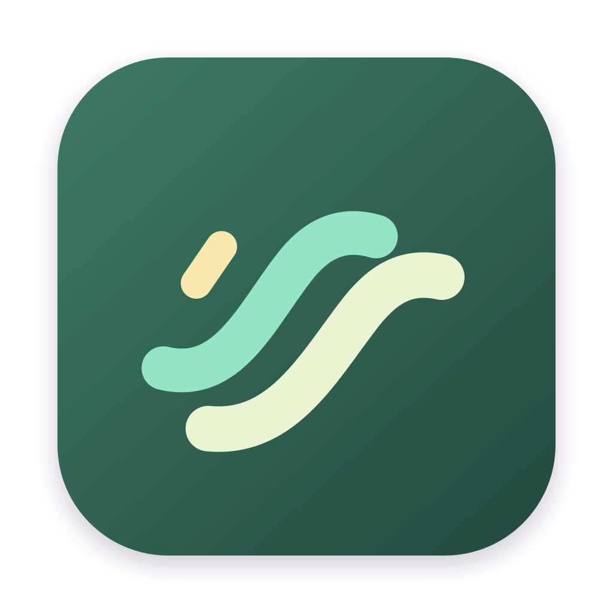

# MouseEasy

**让 Mac 没有难用的鼠标。**

滚轮按你的方向，触控板保留原来的手感。从浏览器切回编辑器，拇指轻点一下侧键就够了。MouseEasy 是一款开源的 Mac 鼠标工具。

[下载 Mac 版](https://github.com/YY-FAN/MouseEasy/releases/latest) · [首次安装](#下载与安装) · [English](#english) · [开发与构建](docs/development.md)

## 让鼠标按你的习惯工作

- **给滚轮一点平滑。** 全新安装时，普通刻度滚轮默认使用「流畅滚动」。纵向滚动先沿用系统方向，想反转时在「滚动」页点一下即可。
- **给两个侧键分个工。** 打开「按钮」，套用「窗口切换」。短按 #3 在当前应用的窗口之间切换，短按 #4 切换应用。点动作名就能换成其他操作。
- **换鼠标，接着用。** 把常用设置放在「所有鼠标」里。换上没有侧键的办公鼠标，滚动方向和平滑设置仍会生效。某个应用需要不同手感时，可以只为它单独设置。
- **按任务微调。** 可以调节指针速度和加速度，将 Ctrl＋滚轮设为缩放，也可以单独调整 iPhone 镜像里的滚动速度和收尾时间。镜像里的手感仍在不同应用中测试。

## 下载与安装

MouseEasy 1.0 的 DMG 适用于 **Apple 芯片 Mac，macOS 12 或更高版本**。界面支持简体中文和英文。

1. 打开本仓库的 **Releases**，从版本的 **Assets** 下载 `.dmg`。
2. 打开 DMG，把 MouseEasy 拖入「应用程序」，推出磁盘映像，再从「应用程序」打开。升级时先退出旧版，替换应用后会继续读取原配置。
3. 跟随应用提示，在「系统设置 → 隐私与安全性」允许 MouseEasy 控制鼠标输入。此安装包采用临时签名，尚未经过 Apple 公证。若 macOS 提示无法验证开发者，可按 [Apple 的首次打开说明](https://support.apple.com/zh-cn/102445) 操作。

## English

**Make every mouse feel at home on Mac.**

MouseEasy is an open-source mouse utility for macOS. Reverse your mouse wheel while keeping your trackpad’s scrolling direction, smooth out a notched wheel, or use your thumb buttons to switch windows and apps. Share your settings across mice, then override them for individual apps or tune scrolling separately for iPhone Mirroring.

On an Apple silicon Mac running macOS 12 or later, download the DMG from [Releases](https://github.com/YY-FAN/MouseEasy/releases/latest). Drag MouseEasy to **Applications**, eject the disk image, then launch the app and follow the mouse-control permission prompt. This build is ad hoc signed and has not been notarized. [Apple’s guide to opening downloaded apps](https://support.apple.com/en-us/102445)

## 致谢与许可

MouseEasy 基于 [LinearMouse 0.13.0](https://github.com/linearmouse/linearmouse/tree/v0.13.0)，沿用了它的设备匹配、指针调节和按钮映射能力，并在其基础上开发了「流畅滚动」预设和 iPhone 镜像适配。感谢 LinearMouse 的贡献者，也感谢 Mos 在滚动手感上的启发。MouseEasy 采用 [MIT 许可证](LICENSE)，第三方组件的声明随安装包分发。
