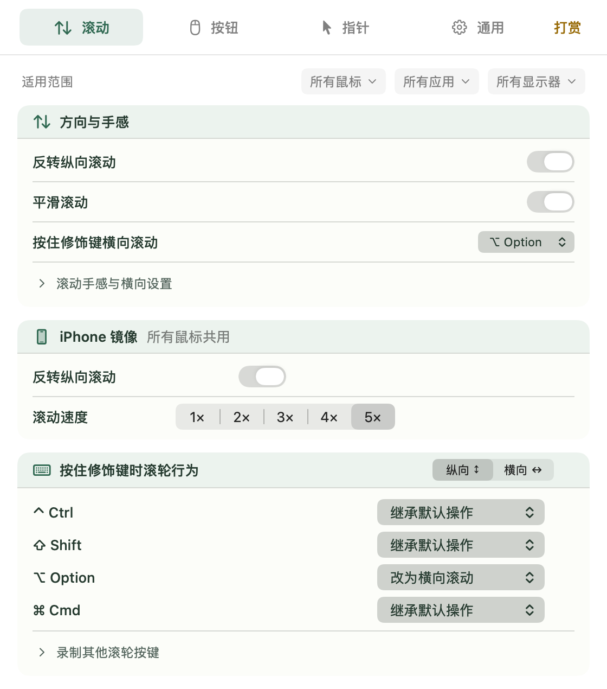

# MouseEasy

[简体中文](#让鼠标按你的习惯工作) · [English](#english) · [下载 / Download](https://github.com/YY-FAN/MouseEasy/releases/latest)

**让 Mac 没有难用的鼠标。**

MouseEasy 是基于 LinearMouse 开发的开源 macOS 鼠标工具。它为 **iPhone 镜像提供独立的滚轮反转和 1–5 倍速设置**，同时提供平滑滚动、侧键自定义、指针调节和按应用设置。通用鼠标配置可以带到下一只鼠标上。

Built on LinearMouse, MouseEasy adds **dedicated scroll reversal and 1×–5× wheel speed for iPhone Mirroring**, alongside smooth scrolling, button remapping, pointer controls and per-app settings. Shared mouse preferences carry over when you change mice.

## 让鼠标按你的习惯工作

- **iPhone 镜像单独调。** 在「滚动 → iPhone 镜像」设置纵向反转与 1–5 倍滚动速度。镜像中的横向滚动也使用所选倍速。这组设置由所有鼠标共用，与其他应用的滚动手感分开调整。
- **平滑鼠标滚轮。** 普通刻度滚轮可以使用「流畅滚动」等预设，反转纵向与横向分别控制。展开模块内的设置，可继续调整速度、响应和惯性。
- **按住修饰键横向滚动或缩放。** 在一级页面选择 Option、Shift 等修饰键，下方「按住修饰键时滚轮行为」会同步显示对应操作。也可以把 Ctrl＋滚轮设为缩放。
- **让侧键切换窗口和应用。** 两个侧键都未绑定时，在「按钮」页使用「窗口切换」预设。短按 #3 切换当前应用的窗口，短按 #4 切换应用。点击操作名称即可更换动作。
- **区分默认设置、应用设置与例外。** 点「所有应用」选择适用范围。默认规则用于所有应用，单独设置覆盖默认规则，加入「例外」的应用则暂停全部 MouseEasy 输入设置。移出例外后恢复之前的规则。
- **换鼠标，接着用。** 将常用的方向、滚动和按钮设置保存到「所有鼠标」。新鼠标会继承这些设置，对应按钮实际触发时才执行绑定。
- **指针与界面按习惯调整。** 调整指针速度、加速度，在应用内查看设置说明。界面支持简体中文和英文，常用操作直接显示，细节在当前模块内展开。

## 下载与安装

**当前版本为 v1.1，构建 47。** 安装包面向 **Apple 芯片 Mac，macOS 12 或更高版本**，界面支持简体中文和英文。iPhone 镜像另需满足 Apple 的设备和系统要求。[iPhone 镜像要求](https://support.apple.com/zh-cn/120421)

1. 从 [GitHub Releases](https://github.com/YY-FAN/MouseEasy/releases/latest) 下载 `MouseEasy-1.1.dmg`。
2. 升级前退出 MouseEasy。打开 DMG，双击 `MouseEasy.pkg`，按安装器提示完成安装，然后从「应用程序」打开 MouseEasy。安装器统一更新 `/Applications/MouseEasy.app`，保留原有配置。
3. 安装包采用临时签名，尚未经过 Apple 公证。若 macOS 提示无法验证开发者，请按 Apple 的首次打开说明操作。[Apple 打开说明](https://support.apple.com/zh-cn/102445)
4. 按应用提示授予鼠标控制权限。若升级后已有授权条目仍无法启用，请先选中旧 MouseEasy 条目并点「−」移除，再添加新版应用并打开开关。

全新安装默认在「所有鼠标」中为普通刻度滚轮启用「流畅滚动」，纵向跟随系统方向，触控板与连续滚动设备保留原有手感。侧键通过预设主动添加。**升级读取现有配置，保留你的方向、速度、按键和应用规则。**

界面语言可在「通用」中切换。隐藏 Dock 和菜单栏图标后，可从「应用程序」再次打开设置，并在「通用 → 启动与显示」退出。右上角「打赏」提供 PayPal 主页和账号复制入口。

[v1.1 更新说明](https://github.com/YY-FAN/MouseEasy/releases/tag/v1.1) · [详细安装说明](docs/download.html) · [开发与构建](docs/development.md) · [功能检查方法](docs/功能与验收.md)

## 致谢与许可

MouseEasy 基于 [LinearMouse 0.13.0](https://github.com/linearmouse/linearmouse/tree/v0.13.0)，沿用并扩展其设备匹配、指针调节和按钮映射能力。MouseEasy 新增了「流畅滚动」预设、iPhone 镜像适配、紧凑的双语设置界面和应用例外管理。感谢 LinearMouse 的贡献者，也感谢 Mos 在滚动手感上的启发。

MouseEasy 采用 [MIT 许可证](LICENSE)，安装包内附第三方许可声明。平滑滚动采用独立实现。

## English

**Make every mouse feel at home on Mac.**

MouseEasy is an open-source macOS mouse utility built on LinearMouse. It adds dedicated wheel reversal and five speed presets for iPhone Mirroring, smooths notched wheels, and brings shared settings to your next mouse.

### Make your mouse work the way you do

- **Tune iPhone Mirroring separately.** Under **Scrolling → iPhone Mirroring**, choose vertical reversal and a speed from 1× to 5×. Horizontal scrolling uses the same speed multiplier. These mirroring controls apply to all mice and are independent of wheel tuning in other apps.
- **Smooth your mouse wheel.** Use the Flow preset for notched wheels and control vertical and horizontal reversal separately. Expand the module to adjust speed, responsiveness and inertia.
- **Hold a modifier to scroll horizontally or zoom.** Choose Option, Shift or another modifier on the main page. **Wheel behavior with modifier keys** shows the same assignment. You can also assign zoom to Ctrl + scroll.
- **Switch windows and apps with side buttons.** If both side buttons are unassigned, use the window-switching preset under **Buttons**. A short press on #3 cycles through windows in the current app, and #4 switches apps. Click an action name to change it.
- **Manage defaults, app overrides and exceptions.** Click **All Apps** to choose a scope. App-specific settings override defaults. Adding an app to **Exceptions** pauses all MouseEasy input adjustments in that app. Removing the exception restores its previous rules.
- **Keep your preferences when you change mice.** Save common wheel and button settings under **All Mice**. New mice inherit these preferences. A button mapping runs when its corresponding button is pressed.
- **Adjust the pointer and interface.** Change pointer speed and acceleration, with explanations available in the app. The compact interface supports English and Simplified Chinese. Common settings are visible, and detailed controls expand inside each module.

The screenshots above show the Simplified Chinese interface.

### Download and install

**The current release is v1.1, build 47.** The installer supports **Apple silicon Macs running macOS 12 or later**. iPhone Mirroring has additional device and system requirements. [Apple’s iPhone Mirroring requirements](https://support.apple.com/en-us/120421)

1. Download `MouseEasy-1.1.dmg` from [GitHub Releases](https://github.com/YY-FAN/MouseEasy/releases/latest).
2. Quit MouseEasy before updating. Open the DMG and double-click `MouseEasy.pkg`, complete installation, then open MouseEasy from Applications. The installer updates `/Applications/MouseEasy.app` and preserves your settings.
3. The app is ad hoc signed and has not been notarized by Apple. If macOS cannot verify the developer, follow Apple’s first-launch instructions. [Apple’s instructions](https://support.apple.com/en-us/102445)
4. Grant mouse-control access when prompted. If an existing permission entry fails after an update, remove the old MouseEasy entry with the minus button, add the updated app and enable its switch.

On a fresh install, **All Mice** uses the Flow preset for notched wheels and follows the system’s vertical scroll direction. Trackpads and continuous-scrolling devices retain their usual behavior. Side-button bindings are added through the preset. **Upgrades load your existing direction, speed, button mappings and app rules.**

Change the interface language under **General**. If you hide both the Dock and menu bar icons, reopen MouseEasy from Applications to return to settings. Quit is available under **General → Startup & appearance**. The **Tip** button opens a popover with a PayPal link and account-copy action.

[v1.1 release notes](https://github.com/YY-FAN/MouseEasy/releases/tag/v1.1) · [Detailed installation guide](docs/download.html#en) · [Development and build guide (Chinese)](docs/development.md) · [Feature checks (Chinese)](docs/功能与验收.md)

### Credits and license

MouseEasy is based on [LinearMouse 0.13.0](https://github.com/linearmouse/linearmouse/tree/v0.13.0), retaining and extending its device matching, pointer controls and button mapping. MouseEasy adds the Flow preset, iPhone Mirroring support, a compact bilingual settings interface and app exceptions. Thanks to the LinearMouse contributors, and to Mos for inspiring the scrolling feel.

MouseEasy is released under the [MIT License](LICENSE). The app includes third-party license notices. Its smooth-scrolling implementation was developed independently.
